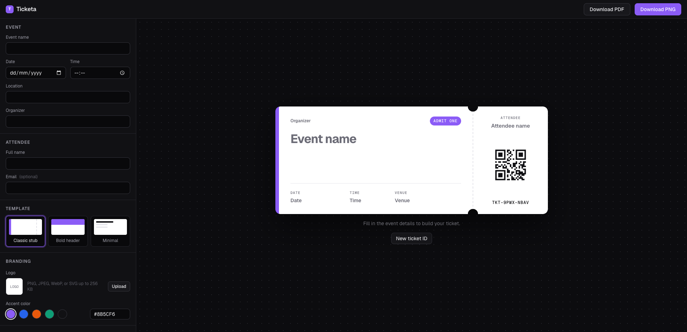

<div align="center">

# Ticketa

**Turn event and attendee details into a polished event ticket, with a live preview and PNG/PDF export. No account required.**

[](https://ticketa-nine.vercel.app/)


<br />



</div>

---

## Overview

Ticketa is a single-page ticket generator. Fill in the event and attendee, pick a
template, add your logo and brand color, and the ticket updates as you type.
When it looks right, download it as a high-resolution PNG or a print-ready PDF.

Exports are rendered on the server by headless Chrome from the **same React
templates** as the preview, so the file you download matches what you see.
Your data is saved only in your browser. There is no database and no sign-up.

## Features

- **Live preview.** The ticket re-renders on every keystroke and scales to fit the screen.
- **Three templates.** Classic stub, Bold header, and Minimal, all on a shared theme.
- **Brand customization.** Upload a PNG, JPEG, WebP, or SVG logo (up to 256 KB) and choose an accent color from presets or a custom hex.
- **Unique ticket IDs and QR codes.** Each ticket gets an ID such as `TKT-ABCD-2345`, encoded as a crisp SVG QR code. You can generate a new ID at any time.
- **PNG export.** A transparent-background PNG at 3× scale.
- **PDF export.** The ticket at true size, centered on a single A4 landscape page.
- **Ticket history.** Every exported ticket is saved locally, so you can reopen it, edit it, and export it again.
- **Local persistence.** Your latest form values, branding, and template survive page reloads, using `localStorage`.
- **Validation.** Inline, accessible error messages, with date/time formatting and length limits (120 characters per text field, 254 for email).
- **Responsive UI.** A stacked layout on mobile and a side-by-side editor and preview on desktop.
- **Production hardening.** Export bodies are capped at 512 KB, each render has a 20-second deadline, and each server instance runs at most two renders at once.

## Tech stack

| Area | Tools |
| --- | --- |
| Framework | [Next.js 16](https://nextjs.org) (App Router, Turbopack), [React 19](https://react.dev) |
| Language | [TypeScript 5](https://www.typescriptlang.org) |
| Styling | [Tailwind CSS v4](https://tailwindcss.com) (via `@tailwindcss/turbopack`), [shadcn/ui](https://ui.shadcn.com) on [Base UI](https://base-ui.com) |
| Validation | [Zod 4](https://zod.dev) |
| QR codes | [`qrcode`](https://www.npmjs.com/package/qrcode) |
| Export rendering | [Puppeteer](https://pptr.dev) locally; [`puppeteer-core`](https://www.npmjs.com/package/puppeteer-core) with [`@sparticuz/chromium`](https://github.com/Sparticuz/chromium) on Vercel |
| Hosting | [Vercel](https://vercel.com) |

## Getting started

### Prerequisites

- **Node.js 24.x** (declared in `package.json` `engines`)
- **npm** (the repository ships a `package-lock.json`)

### Install and run

```bash
git clone https://github.com/labrahimiimrane/ticketa.git
cd ticketa
npm install
npm run dev
```

Open [http://localhost:3000](http://localhost:3000).

`npm install` also downloads a local Chrome for Puppeteer, which PNG/PDF export
uses in development. No environment variables are required.

> [!NOTE]
> Export loads the app's own `/render/ticket` page in headless Chrome, so the
> server must be running on the port it expects (`PORT`, default `3000`). To
> point the renderer at a different origin, set `RENDER_ORIGIN`.

## Scripts

| Command | Description |
| --- | --- |
| `npm run dev` | Start the development server at `http://localhost:3000` |
| `npm run build` | Create a production build |
| `npm run start` | Serve the production build |
| `npm run lint` | Run ESLint |
| `npx tsc --noEmit` | Type-check the project (there is no package script for this) |

There is no automated test suite yet.

## Export API

The UI calls two Route Handlers that accept the same JSON body:

- `POST /api/export/png`
- `POST /api/export/pdf`

```json
{
  "event": {
    "name": "Launch Night",
    "date": "2026-11-20",
    "time": "19:30",
    "location": "Main Hall",
    "organizer": "Ticketa"
  },
  "attendee": { "name": "Sam Lee" },
  "ticketId": "TKT-ABCD-2345",
  "templateId": "classic",
  "branding": { "logo": null, "colors": { "accent": "#8B5CF6" } }
}
```

| Status | Body | Meaning |
| --- | --- | --- |
| `200` | file | Rendered PNG or PDF, sent as an attachment |
| `400` | `{"error":"invalid_json"}` / `{"error":"invalid_ticket"}` | Malformed JSON or a body that fails validation |
| `413` | `{"error":"too_large"}` | Body larger than 512 KB |
| `503` | `{"error":"busy"}` | All render slots on this instance are taken (sent with `Retry-After: 5`) |
| `504` | `{"error":"render_timeout"}` | The render missed its 20-second deadline |
| `500` | `{"error":"render_failed"}` | Any other render failure |

`templateId` is one of `classic`, `bold`, or `minimal`. `attendee.email` is
optional, and `branding.logo` is either `null` or a base64 image data URL.

## Project structure

```text
.
├── app/
│   ├── api/export/{png,pdf}/route.ts   # Export Route Handlers
│   ├── render/ticket/page.tsx          # Export-only page that headless Chrome renders
│   ├── layout.tsx, page.tsx, globals.css
├── components/
│   ├── generator/                      # Editor: form, template picker, branding, history
│   ├── ticket/                         # Ticket templates and QR code
│   ├── export/RenderTicket.tsx         # Client view that receives the ticket from Puppeteer
│   └── ui/                             # shadcn/ui primitives
├── lib/
│   ├── export/                         # Request schema, request handling, Puppeteer rendering
│   ├── ticket-schema.ts, branding.ts   # Zod validation
│   ├── local-state.ts, ticket-history.ts  # localStorage persistence
│   └── ticket-id.ts, ticket-templates.ts, format-ticket-date.ts
├── types/ticket.ts                     # Shared ticket types
├── next.config.ts                      # Cache Components, Tailwind loader, Chromium tracing
└── .puppeteerrc.cjs                    # Skips Puppeteer's Chrome download on Vercel
```

`blueprint/`, `.claude/`, and `.agents/` hold the planning docs and AI-assisted
development workflow used to build the project. They are not part of the runtime app.

## Deployment

Ticketa deploys to Vercel as a standard Next.js project. Export runs Puppeteer
inside a Vercel function using the serverless Chromium build from
`@sparticuz/chromium`, and Vercel builds skip Puppeteer's own Chrome download (see
`.puppeteerrc.cjs`). No environment variables are needed.

1. In the Vercel dashboard choose **Add New > Project** and import the repository.
   The Next.js preset and build settings are detected automatically.
2. Export loads the deployment's own `/render/ticket` page, so the deployment must
   be publicly reachable. Preview deployments sit behind Vercel Authentication by
   default; turn it off in **Settings > Deployment Protection** to test previews.
3. When the deployment is ready, run the smoke checks below against its URL.

<details>
<summary><strong>Smoke checks</strong></summary>

```bash
URL=https://<your-deployment>.vercel.app
BODY='{"event":{"name":"Launch Night","date":"2026-11-20","time":"19:30","location":"Main Hall","organizer":"Ticketa"},"attendee":{"name":"Sam Lee"},"ticketId":"TKT-ABCD-2345","templateId":"classic","branding":{"logo":null,"colors":{"accent":"#8B5CF6"}}}'

curl -s -o /dev/null -w "GET / %{http_code}\n" "$URL/"
curl -s -o ticket.png -w "PNG %{http_code} %{content_type}\n" -H "Content-Type: application/json" -d "$BODY" "$URL/api/export/png"
curl -s -o ticket.pdf -w "PDF %{http_code} %{content_type}\n" -H "Content-Type: application/json" -d "$BODY" "$URL/api/export/pdf"
```

Expect `200` for all three, `image/png` and `application/pdf` content types, and
files that open and match the preview. To try it locally, run `npm run build`
and `npm run start`, then use `URL=http://localhost:3000`.

To check the concurrency limit, send a burst. Each instance returns at most two
`200` responses at once; the rest get `503` with `Retry-After: 5`:

```bash
for i in 1 2 3 4; do
  curl -s -o /dev/null -w "PNG %{http_code}\n" -H "Content-Type: application/json" -d "$BODY" "$URL/api/export/png" &
done; wait
```

</details>

## Privacy

Ticketa has no accounts and no database. Form values, branding, and ticket
history are stored only in your browser's `localStorage`. Export requests send
the ticket data to the server for rendering, and the generated files are
returned directly and never stored.
